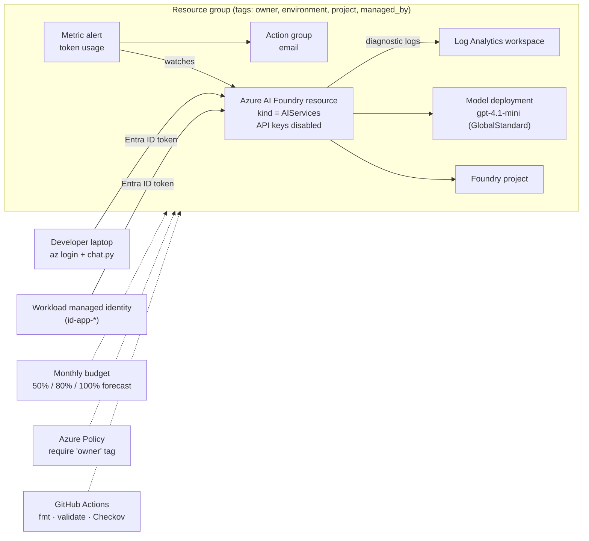

# Azure AI Foundry Sandbox: Governed, Keyless, Deployed with Terraform

A reusable infrastructure-as-code deployment of a **sandbox Azure AI Foundry environment** with
identity-based access, monitoring, cost controls and policy, plus a small Python client that calls
the deployed model **without any API key**.

## Architecture



## What gets deployed

| Area | Resource | Why |
|---|---|---|
| AI platform | Foundry resource (`AIServices`), Foundry project, `gpt-4.1-mini` deployment | The workspace AI teams build on |
| Identity | User-assigned managed identity + `Cognitive Services OpenAI User` role, scoped to the Foundry resource only | Least-privilege, secretless access for workloads |
| Identity | Same role for the deployer | Lets the local client authenticate with `az login` |
| Security | `disableLocalAuth = true` | API keys are switched off; Entra ID is the only way in |
| Observability | Log Analytics workspace + diagnostic settings (all logs) | Audit and request logs in one place, queryable with KQL |
| Observability | Metric alert on processed tokens + email action group | Early warning on unexpected usage |
| Cost | Resource-group budget with 50% / 80% / 100%-forecast notifications | Protects the sandbox credit |
| Governance | Consistent tags + Azure Policy "Require a tag on resources" (`owner`) | Every resource is attributable |

## Key design decisions

- **Keyless by design.** Local auth is disabled on the Foundry resource, so there are no keys to leak,
  rotate or store. That's also why there is no Key Vault in this sandbox: there are no secrets to put in it.
- **Least privilege.** Identities get a data-plane role (call models) on one resource, not
  Contributor on the resource group or subscription.
- **Everything is code.** Nothing is created in the portal; `terraform destroy` removes it all.
- **Region and model chosen from real constraints.** The subscription's *Allowed locations* policy and
  per-model quota (`az cognitiveservices usage list`) decided `polandcentral` + `gpt-4.1-mini`.
  Both are variables.

## Quick start

```powershell
az login --tenant <tenant-id>
cd infra
copy terraform.tfvars.example terraform.tfvars   # then edit it
terraform init
terraform plan -out tfplan
terraform apply tfplan

cd ..
python -m venv .venv; .\.venv\Scripts\Activate.ps1
pip install -r app/requirements.txt
python app/chat.py "Explain private endpoints in two sentences."
```

Full steps, verification, troubleshooting and teardown are in **[docs/runbook.md](docs/runbook.md)**.
The network, identity and security checklist is in **[docs/security-checklist.md](docs/security-checklist.md)**.

## Repository layout

```
infra/                 Terraform (azurerm + azapi)
  main.tf              all resources
  variables.tf         inputs with defaults
  outputs.tf           endpoints, names, identity client ID
app/chat.py            keyless Python client (DefaultAzureCredential)
docs/runbook.md        deploy · verify · access requests · troubleshoot · decommission
docs/security-checklist.md
.github/workflows/     CI: terraform fmt/validate, Checkov scan, ruff
```

## CI

Every push runs `terraform fmt -check`, `terraform validate`, a **Checkov** IaC security scan and
`ruff` on the Python client. CI needs no Azure credentials. Planned next step: GitHub OIDC federation
to run `terraform plan` against Azure on pull requests.

## Cost

Idle cost is close to zero: the model deployment is pay-per-token, and the Log Analytics workspace
has a 1 GB/day cap. Run `terraform destroy` when you're done.

## Next steps (production hardening)

1. Private endpoint + private DNS zones for the Foundry resource; `publicNetworkAccess = Disabled`
2. Controlled outbound access through a firewall / NAT
3. Remote Terraform state in Azure Storage with state locking
4. OIDC-based `plan`/`apply` pipeline with manual approval for `apply`
5. Azure Monitor workbook dashboard for availability, latency, tokens and cost
